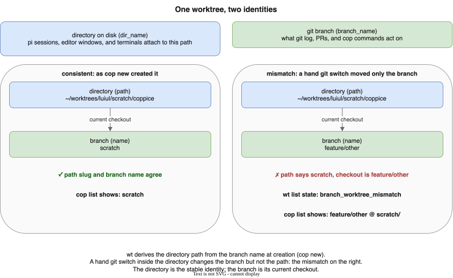

# coppice

[](https://github.com/luiul/coppice/actions/workflows/ci.yml)
[](LICENSE)

A path-based CLI for managing git worktrees across every repo on your
machine, from a single set of commands. Built on top of
[`wt`](https://worktrunk.dev) (worktrunk), which does the actual worktree
work; `coppice` adds what `wt` doesn't: commands that reach across *all*
your repos from *anywhere* on disk.

## Why

Git worktrees give each branch its own directory, all sharing one `.git`
history, so several branches can be checked out at once. But `wt` (and
raw `git worktree`) only operate on one repo, from inside it. `coppice`
turns that into a cross-repo workflow:

- **Parallelize work in a single repo.** A human and any number of
  agents work in the same repo at once, each in their own worktree. No
  stashing, no branch switching.
- **Reach every repo, from anywhere.** A shared registry tracks every
  repo `coppice` has touched, so `list`/`clean` sweep all of them from
  any directory.
- **Automate worktree setup.** `wt`'s lifecycle hooks turn `cop new` from an empty checkout into a ready dev environment: venv, `.env`, and other setup defined in your worktrunk config. Coppice does not choose or open an editor window.

The long version, with diagrams: [docs/why-worktrees.md](docs/why-worktrees.md).
How coppice relates to `wt`, understory, and canopy:
[docs/ecosystem.md](docs/ecosystem.md).

## Install

**Prerequisite:** [`wt`](https://worktrunk.dev) (worktrunk) on `PATH`;
`coppice` shells out to it for every worktree operation. With the repo
cloned:

```bash
uv tool install -e .
```

Then, so `cop new` can `cd` you into the worktree it creates, add shell
integration to your rc file:

```bash
# zsh (~/.zshrc) or bash (~/.bashrc)
eval "$(coppice shell init zsh)"   # or: bash
```

`fzf` (interactive picker for `cop remove`) and [`gh`](https://cli.github.com/) (PR information for `cop list` and open-PR detection for `cop clean`) are optional and auto-detected.

## Usage

```bash
cop new ~/dbt-models          # create branch + worktree for a repo, from anywhere
cop sync                      # merge each repo's base remote into every worktree
cop list                      # worktrees across every known repo
cop clean --dry-run           # preview worktrees older than 14 days
cop remove my-branch          # remove a worktree by branch name
```

Full reference, prompt behavior, and safety rails:
[docs/commands.md](docs/commands.md). A full terminal session:
[docs/demo.md](docs/demo.md).

## Worktree listing

`cop list` groups worktrees by repo. Wide terminals show tables. Narrow terminals show full labeled cards, with the same fields rather than dropped columns or combined status cells.

Each shown repo includes its main worktree as a row. `Main` means the original worktree from `git init` or `git clone`, not the default branch. `Linked` means an additional worktree. Branch and HEAD state are separate. Detached HEAD shows Branch `N/A` and HEAD state `Detached`. Current, Prunable, and Path mismatch also have separate fields. Repos with only a main worktree are hidden in the multi-repo view unless you pass `--all`. An explicit repo path shows its main worktree.

The display separates staged, unstaged, untracked, and unmerged path counts. It also separates directory creation, HEAD commit time, latest local file change, parked time, and follow-up. Missing time evidence shows `Unknown`, without a fallback to another time. Times use ISO format with the local UTC offset. `cop list -v` shows full paths and wraps them when needed. `--size/--no-size` keeps the existing disk-usage behavior.

Ahead, Behind, and HEAD contained use a named local ref, `refs/heads/<cached default name>`. The name comes from Worktrunk's cached default, with cached `origin/HEAD` as a fallback. It never comes from the main worktree's checked-out branch. Missing refs or shallow history show `Unknown`. Worktrunk's reported relation, content integration, integration method, predicted conflicts, and comparison target stay separate. Schema 1 does not name its exact target ref, so the target shows `Unknown`. Predicted conflicts needs explicit evidence for `Yes`; other compared states do not imply `No`. Those results do not prove local HEAD ancestry or permission to remove a checkout.

Tracking remote, Tracking branch, Tracking ahead, and Tracking behind display Worktrunk's existing cached tracking data. They add no collection or network calls. The upstream can be a feature branch, not the remote default. Cached tracking counts are not fresh remote evidence.

Run `cop list --explain` for a concise field glossary without a Git, `gh`, or `wt` scan. See [the glossary](docs/glossary.md) and [the full list reference](docs/commands.md#list-layout-and-local-fields). JSON fields and collection, cleanup, and the `cop new` preview stay unchanged.

## PR visibility

`cop list` shows PR lookup, PR state, PR number, and Additional PRs as separate fields. PR lookup does not depend on an open Orca tab. Collected branch rows use the GitHub repo named by `origin`.

Lookup distinguishes `Complete`, `Unknown`, `N/A`, and `Not checked`. `Complete` with PR state `None` means no PR matches. State identifies the selected PR as Draft, Open, Merged, or Closed. Main display rows do not promise PR checks; a row without collected evidence shows `Not checked`.

Open and draft PRs take priority. Otherwise, the most recently updated closed or merged PR appears. Additional PRs counts other matches for the same repo and branch. Run `cop list --pr-detail` to see all matching PRs with full URLs. A match uses the branch name and repo, so a deleted and reused branch can match an older PR.

Use `cop link-pr PATH` to attach the displayed PR to an existing Orca workspace. It refuses an ambiguous workspace and does not create one. Use `cop list --no-pr` to skip the lookup. `cop list --json` stays unchanged and does not check PRs. Lookups use complete pagination and bounded concurrent calls, without a cache. Upstream PR discovery for forks, GitHub Enterprise, and branches without worktrees are not included.

## Remote default

`cop list` also shows whether a checked worktree's current committed HEAD reached the fresh actual `origin` default branch. The repo metadata names the remote and default branch separately, with the observed remote commit and check time. Including the main worktree as a display row does not promise a remote check; uncollected rows show `Not checked`.

| Remote default cell | Meaning |
|---|---|
| `Reached` | Current HEAD is in the remote default history, or exact merged-PR evidence confirms integration. |
| `Pending` | Complete ancestry and commit-associated PR checks found no integration into that target. |
| `Unknown` | Evidence is unavailable, incomplete, or the checkout changed during the check. |
| `N/A` | No supported GitHub origin or active branch can be checked. |
| `Not checked` | No remote-default result was collected for this row. |

The check supports direct integration and PR merges, including squash merges with an exact original head and a reachable merge commit. A renamed branch can still match through commit identity. Newer commits do not inherit an older PR's merge result. A local-only commit that GitHub cannot compare shows `Unknown`, not `Pending`.

`Reached` describes committed HEAD, not dirty edits, live deployment, or removal permission. Local ancestry, Worktrunk content integration and predicted conflicts, and branch-name PR history stay separate. Use `--no-remote-default` to skip this check. Use `--no-pr --no-remote-default` for a listing without GitHub checks. JSON remains unchanged and performs neither lookup. Checks do not fetch or change Git refs. The display adds no new family of network calls.

## Pi in Orca or Herdr

Use an explicit orchestrator command to start work. Both commands use wt to create or reuse a worktree, finish setup, start or reuse Pi, focus its terminal, and enter the worktree through shell integration. The selected orchestrator must be running.

```zsh
cop orca                                 # current repo, prompt for a branch description
cop herdr                                # same workflow in Herdr
cop orca ~/projects/personal/my-repo      # a repo path from anywhere
cop herdr ~/projects/personal/my-repo
cop orca --branch fix-import              # choose a branch
cop herdr --branch fix-import --yes       # reopen a branch without the reuse confirmation
cop new --branch experiment               # worktree only, no orchestrator action
```

All three commands accept a repo path, including a subdirectory or linked worktree within it. They support `--branch`, `--base`, and `--yes`. Without `--branch`, they use the existing branch-description prompt. A linked-worktree path does not silently select its branch.

`cop new` uses normal wt hooks and never contacts either orchestrator. Direct wt calls also open no Herdr or Orca workspace. The explicit workflows finish configured user setup before launching Pi. Agent-marked and piped calls do not start this workflow. Repo-file or system background setup needs an explicit readiness barrier; Coppice stops before creation rather than race it.

`cop orca` registers the main checkout and shows external worktrees. You no longer need to call `owa` first. That helper remains available for watch-only use. Orca's native worktree creation is not used.

`cop herdr` needs the Worktrunk helper `wt-herdr` on PATH. It checks the Herdr app and Core before creating a checkout. After setup, it passes the exact repo and checkout paths to the helper. The helper owns space grouping, Pi reuse and launch, and terminal focus. Legacy Herdr sessions and `--session` are not supported. The global wt config has no Herdr launch hook.

Setup has a 240-second deadline. Calls and launch readiness are bounded. Orca discovery waits at most 45 seconds. Herdr helper checks have a 10-second deadline, and opening has a 90-second deadline. If a handoff fails after creation, the checkout remains and shell navigation still works; the command returns a failure status and prints a complete retry with the repo and branch.

```zsh
cop orca /path/to/repo --branch fix-import --yes
cop herdr /path/to/repo --branch fix-import --yes
```

Retries finish pending setup, safely reuse Pi, and focus its terminal. They do not create an extra worktree or agent. If a launch or terminal identity is uncertain, Coppice stops rather than risk a duplicate. A title alone is not proof of a running Pi.

Opening Orca's verified Pi terminal binds its terminal state. Hide sleeping keeps the worktree visible, even when Pi is idle.


## Concepts

### Vocabulary

[docs/glossary.md](docs/glossary.md) defines the terms and field meanings, with [Git's official worktree terms](https://git-scm.com/docs/git-worktree). Git facts, Coppice task state, and Worktrunk comparison results are separate.

- **Repo**: the Git database, its commits and refs, and the project around it.
- **Project**: the repo and every attached worktree, named by the main directory's basename.
- **Branch**: a named ref pointing to a commit. It has no location on disk.
- **Worktree**: a checkout with its own files, index, and HEAD, sharing the repo's history. It can use a branch or detached HEAD.
- **Main worktree**: the original worktree made by `git init` or `git clone`. It need not use the default branch.
- **Linked worktree**: an additional worktree made by `git worktree add`, including through `wt`.
- **Checkout**: the branch or detached commit used by a worktree. Git normally permits a branch in only one worktree at a time.
- **Path**: a worktree's directory. Pi sessions, editor windows, and terminals attach to it, not to the branch.
- **Expected path**: the path Worktrunk's template assigns to a branch, such as `~/worktrees/<owner>/<branch-slug>/<project>`.
- **Registry**: the shared known-repo list at `~/.cache/wt/known-repos`, separate from Git's worktree registrations.
- **Scope**: the repos a command uses. An explicit path selects one repo. Without it, `list` uses known repos and the current repo.
- **Current worktree**: the worktree containing your working directory. The display labels it separately from Type and Branch.



### The one rule: branch vs. worktree

A branch has a name and no location. A worktree has a location (its
path) and a current checkout. coppice commands take branch names,
because that's what you think in, but what they create, list, or remove
is the branch's worktree. Every "should we change X" question maps to
exactly one of three operations:

| Operation | What changes | Breaks | Command |
|---|---|---|---|
| **switch** | a worktree's checkout | nothing on disk | `git switch` |
| **relocate** | a worktree's path | path-keyed tools | `cop relocate` |
| **rename** | the branch ref | nothing on disk | `git branch -m` (coppice never does this) |

A worktree at a path that does not match its checked-out branch shows a separate Path mismatch field in `cop list`. The Branch field still names the actual branch. How `cop new` recovers when it needs that path: [docs/recovery.md](docs/recovery.md). How `cop relocate` heals a mismatch afterwards: [docs/worktrees.md](docs/worktrees.md).

### States

| State | Meaning | Consequence |
|---|---|---|
| **dirty** | uncommitted changes | `clean` skips; `remove` refuses without `--force` |
| **legacy merged bucket** | Coppice's grouping of Worktrunk comparison states, not strict Git ancestry | used by the unchanged `clean --merged` filter; not removal permission |
| **stale** | directory gone, git record remains | `clean` always sweeps |
| **parked** | task complete, kept for follow-up | `sync` skips; `remove`/`clean` refuse until `cop unpark` |

Separate Git facts, task state, and integration evidence: [docs/states.md](docs/states.md).
How `cop sync` keeps worktrees current: [docs/sync.md](docs/sync.md).

## Documentation

| Page | Contents |
|---|---|
| [docs/why-worktrees.md](docs/why-worktrees.md) | the value proposition in depth, with diagrams |
| [docs/ecosystem.md](docs/ecosystem.md) | `wt`, understory, canopy, the shared registry |
| [docs/worktrees.md](docs/worktrees.md) | how worktrees share one `.git`; what `cop relocate` moves |
| [docs/glossary.md](docs/glossary.md) | Git, Coppice, and Worktrunk terms and list fields |
| [docs/states.md](docs/states.md) | dirty, stale, parked, and integration evidence |
| [docs/sync.md](docs/sync.md) | `cop sync` semantics |
| [docs/recovery.md](docs/recovery.md) | occupied-path recovery flow |
| [docs/commands.md](docs/commands.md) | full command reference, prompts, registry, shell integration |
| [docs/demo.md](docs/demo.md) | a full terminal session |

## Status

Early days. `new`, `list`, `remove` (with an interactive `fzf` picker),
`clean`, `status`, and shell integration cover the daily loop. See [open
issues](https://github.com/luiul/coppice/issues) for what's not there yet.

## Development

```bash
uv sync --group dev
uv run pytest
uv run ruff check .
uv run ty check
```

## License

MIT, see [LICENSE](LICENSE).
